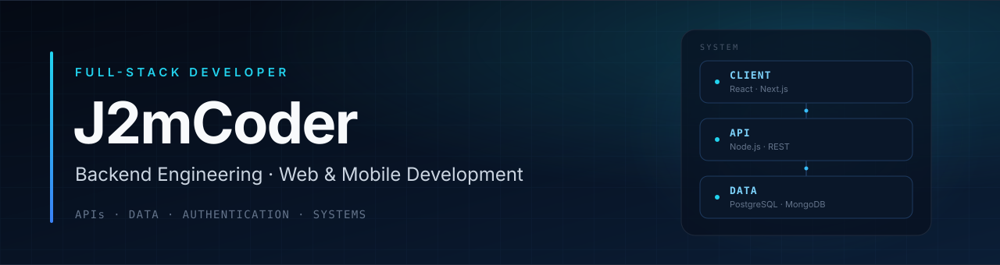

  

<h1 align="center">J2mCoder</h1>

  <strong>Jean de Dieu Mbumba · Full-Stack Web &amp; Mobile Developer</strong> 
  Kinshasa, DR Congo

  <a href="mailto:jeandedieumbumba2802@gmail.com">Email</a> ·
  <a href="https://www.linkedin.com/in/jean-de-dieu-mbumba-7415ba291/">LinkedIn</a> ·
  <a href="https://github.com/J2mCoder?tab=repositories">Repositories</a>

---

## About

I'm **Jean de Dieu Mbumba**, a web and mobile developer based in Kinshasa, DR Congo. I work at **Horizon High-Tech**, mostly on backend systems: data models, REST APIs, authentication, and the interfaces built on top of them.

## Technical Skills

*Technologies I use or explore — depth varies by area.*

- **Frontend** — `React.js` · `Next.js` · `JavaScript` · `TypeScript` · `Tailwind CSS`
- **Backend** — `Node.js` · `Express.js` · `PHP` · `Python` · `FastAPI` · `REST APIs`
- **Databases & ORM** — `MongoDB` · `MySQL` · `PostgreSQL` · `Prisma` · `Mongoose` · `Redis`
- **Artificial Intelligence** — `LLMs` · `Prompt Engineering` · `Function Calling` · `AI Agents` · `RAG` · `Embeddings` · `LangChain` · `Hugging Face` · `Ollama` · `OpenRouter` · `MCP` · `Scikit-learn` · `PyTorch`
- **DevOps & Tools** — `Git` · `GitHub` · `Docker` · `Linux` · `Postman` · `OpenCode`

## Current Focus

- **TKS Solution** — a multi-role platform for mobile airtime distribution in the DRC.
- **Backend** — PostgreSQL data modeling, API design, and error handling.
- **AI** — exploring LLM APIs, agents, and retrieval.

## Featured Projects

### async-express-error

A small TypeScript utility for Express that forwards rejected promises to the error middleware. It has no runtime dependencies, supports Express 4 and 5, and is tested with Jest and GitHub Actions. Published on npm.

`TypeScript` · `Express.js` · `Jest` · `GitHub Actions` · `npm`

[Repository](https://github.com/J2mCoder/async-express-error) · [npm package](https://www.npmjs.com/package/async-express-error)

### TKS Solution

A multi-role platform for mobile airtime distribution in the DRC. It handles client onboarding, agent and administrator roles, pricing, identity documents, and two-factor authentication.

`Next.js` · `TypeScript` · `PostgreSQL` · `Drizzle ORM` · `Better Auth` · `Tailwind CSS`

## GitHub

Most of my current work is in private repositories. You can browse the rest of my public work on [GitHub](https://github.com/J2mCoder?tab=repositories).

## Contact

I'm open to backend and full-stack opportunities.

- **Email** — [jeandedieumbumba2802@gmail.com](mailto:jeandedieumbumba2802@gmail.com)
- **LinkedIn** — [Jean de Dieu Mbumba](https://www.linkedin.com/in/jean-de-dieu-mbumba-7415ba291/)
- **GitHub** — [@J2mCoder](https://github.com/J2mCoder)
